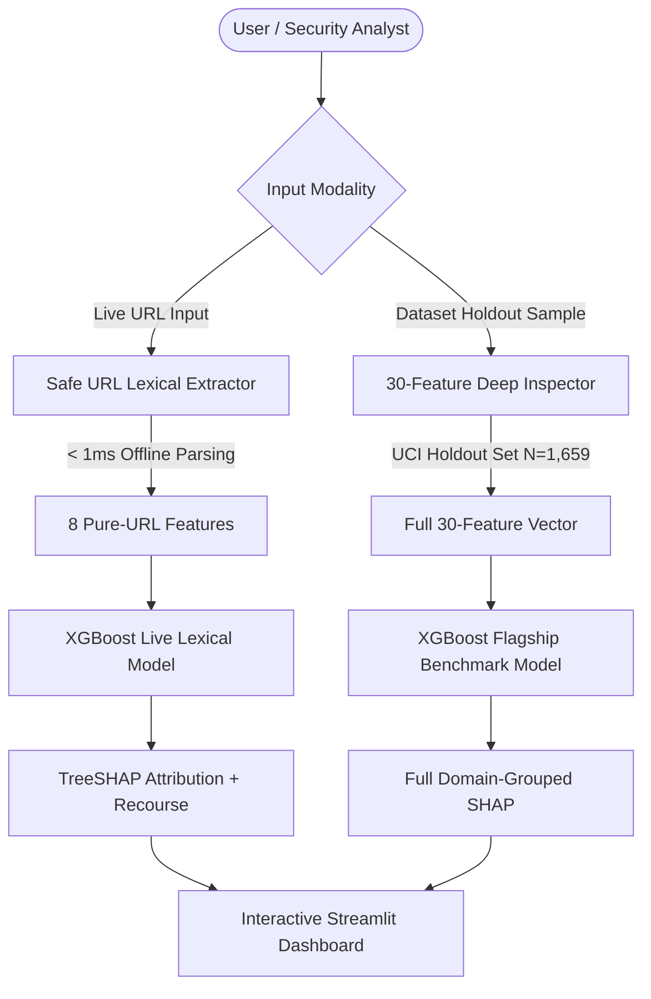

# 🛡️ PhishLens: Explainable Phishing Detection System
### *URL Feature Analysis, Dual-Inference Architecture, and Game-Theoretic Explainability (TreeSHAP)*

[](https://www.python.org/)
[](https://streamlit.io/)
[](https://xgboost.readthedocs.io/)
[](https://shap.readthedocs.io/)
[](https://archive.ics.uci.edu/dataset/327/phishing+websites)
[](LICENSE)

---

## 📌 Overview

Phishing attacks remain the leading threat vector for credential harvesting, corporate espionage, and unauthorized access, with over 5 million campaigns deployed annually and lifespans under 24 hours. While traditional Machine Learning classifiers achieve high accuracy, their black-box nature produces severe operational bottlenecks in Security Operations Centers (SOCs):
- **Warning Fatigue**: Users and analysts hesitate when presented with a blind "Phishing: 98%" score without diagnostic rationale.
- **False-Positive Auditing**: Legitimate new domains (e.g., brand-new corporate portals) are blocked without transparent recourse.
- **The Live-Extraction Fallacy**: Typical academic projects train on static benchmark datasets with obsolete features (e.g., retired Alexa Rank and Google PageRank APIs) and cannot evaluate arbitrary live URLs without network hazards.

**PhishLens** solves these challenges through an **Honest Dual-Inference Architecture** paired with a **Multi-Layer Explainable AI (XAI)** engine based on cooperative game theory (TreeSHAP) and counterfactual recourse.

---

## 🏗️ Dual-Engine Architecture



### 1. Tier 1: Real-Time Lexical Scanner (Live Path)
- Extracts **8 pure lexical features** directly from the URL string without network calls (`having_IP_Address`, `URL_Length`, `Shortining_Service`, `having_At_Symbol`, `double_slash_redirecting`, `Prefix_Suffix`, `having_Sub_Domain`, `HTTPS_token`).
- **Performance**: Sub-millisecond latency (< 1ms).
- **Safety**: 100% offline; zero network footprint; no hazardous port scanning or DOM script execution.

### 2. Tier 2: Dataset Lab & Benchmark Suite (Evaluation Path)
- Evaluates complete 30-feature vectors from the **UCI Phishing Websites Dataset** (11,055 instances).
- Serves as the benchmark for academic comparison, feature ablation, and interactive "what-if" simulations.

---

## 📊 Benchmark & Evaluation Results

All models evaluated on the held-out test split ($N = 1,659$, 15% stratified split, fixed seed `42`):

| Model Architecture | Feature Count | Test Accuracy | Precision | Recall (Catch Phish) | F1-Score | ROC-AUC | PR-AUC | MCC |
| :--- | :---: | :---: | :---: | :---: | :---: | :---: | :---: | :---: |
| **XGBoost Flagship** | **30** | **96.87%** | **96.34%** | **96.60%** | **0.9645** | **0.9944** | **0.9934** | **0.9366** |
| **Random Forest** | 30 | 96.50% | 96.06% | 96.05% | 0.9600 | 0.9936 | 0.9922 | 0.9292 |
| **Logistic Regression** | 30 | 93.49% | 92.54% | 92.93% | 0.9254 | 0.9818 | 0.9786 | 0.8681 |
| **XGBoost Live Lexical**| **8** | **75.89%** | **72.16%** | **76.05%** | **0.7593** | **0.8329** | **0.7712** | **0.5147** |

> [!NOTE]
> **Academic Ablation Finding**: Moving from 30 features (which depend on HTML/DOM scraping and obsolete external reputation APIs) to 8 pure URL lexical features produces an expected accuracy delta of ~20.9%, while delivering an operational speedup of >1000x and eliminating security risks.

---

## 🧬 Explainability (XAI) Framework

PhishLens implements a three-tier explainability protocol:
1. **Game-Theoretic Local Attribution (TreeSHAP)**: Computes exact Shapley values $\phi_i$ for each feature, showing whether it pushes the prediction toward Phishing (Red) or Legitimate (Green).
2. **Domain-Level Group Aggregations**: Groups features into intuitive cybersecurity categories:
   - *Address Bar (Lexical)*
   - *Abnormal & Network State*
   - *HTML & JavaScript DOM*
   - *External Reputation*
3. **Contrastive Recourse / Counterfactual Hints**: Algorithmic generation of actionable what-if guidance:
   > *"If 'Prefix_Suffix' met legitimate criteria (no hyphens in domain), the phishing probability would drop by 31.3%."*
4. **Plain-Language Rule Translation**: Discards raw indices (`-1, 0, 1`) and translates decisions into human-readable cybersecurity diagnostics.

---

## 🚀 Quick Start Guide

### 1. Clone the Repository
```bash
git clone https://github.com/akshat2474/PhishLens.git
cd PhishLens
```

### 2. Set Up Virtual Environment & Dependencies
```bash
python3 -m venv .venv
source .venv/bin/activate
pip install -r requirements.txt
```

### 3. Run the Ingestion & Training Pipeline (Optional, pre-trained artifacts included)
```bash
python src/data_loader.py
python src/models.py
```

### 4. Run Unit Tests
```bash
PYTHONPATH=. pytest tests/
```

### 5. Launch the Streamlit Dashboard
```bash
streamlit run app.py
```
Open your browser at `http://localhost:8501`.

---

## 📁 Repository Structure

```
PhishLens/
├── .gitignore                      # Python, Streamlit, OS, and environment ignore rules
├── README.md                       # Project documentation & academic evaluation
├── requirements.txt                # Pinned production dependencies
├── app.py                          # Multi-tab Streamlit dashboard
├── data/
│   ├── raw/                        # Original Training Dataset.arff & Features docx
│   └── processed/                  # phishing_websites.csv, split_indices.json, feature_catalog.json
├── artifacts/                      # Serialized models (.joblib), metrics, and SHAP backgrounds
│   ├── xgb_full_30.joblib
│   ├── xgb_live_8.joblib
│   ├── rf_full_30.joblib
│   ├── lr_full_30.joblib
│   └── model_metrics.json
├── src/
│   ├── __init__.py
│   ├── data_loader.py              # Ingestion, ARFF parsing, and stratified splitting
│   ├── feature_extractor.py        # Safe URL lexical feature extractor (< 1ms)
│   ├── models.py                   # Multi-model training and evaluation suite
│   └── explainability.py           # TreeSHAP engine, group aggregation, and recourse
└── tests/
    └── test_extractor.py           # Comprehensive unit tests for all 8 lexical rules
```

---

## 🛡️ License

This project is licensed under the MIT License - see the LICENSE file for details.
